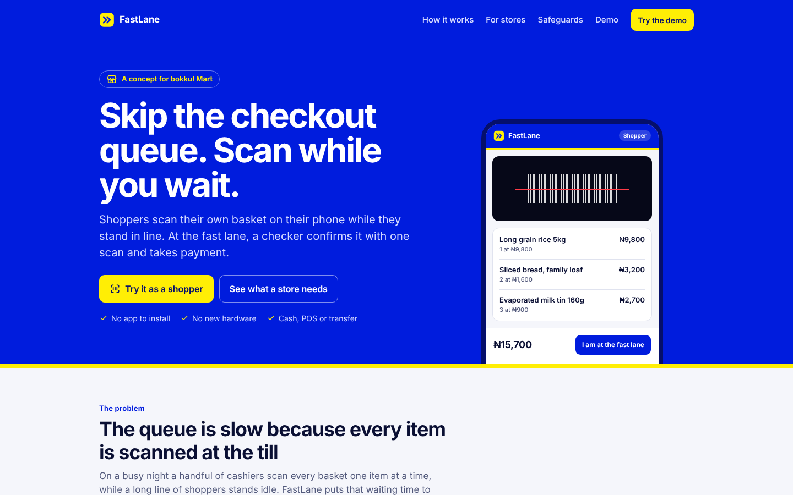

# FastLane

Skip the checkout queue. Shoppers scan their own basket on their phone while they stand in line. At a fast lane, a checker scans one pass, confirms the basket and takes payment by cash, POS or transfer.

There is also an order-ahead mode: reserve a short list of essentials from home, pay, and collect at a pickup counter.

This is a demo for showing to a store. It is not ready to run a live store: see "What the demo does not do".



## Run it

```bash
npm run serve
```

Then open http://localhost:4173. Nothing needs installing to run it: the libraries and fonts are in `vendor/`.

The camera only works on `https://` addresses or on `localhost`, so to use phones, deploy the folder to any static host. There is no build step. On Vercel, import the repository and leave the framework preset as "Other"; `vercel.json` sets the security headers.

## Walk-through

**Scan while you wait** (a laptop and a phone, or two phones):

1. Open `products.html` on a laptop. It shows a sheet of sample barcodes.
2. Open `scan.html` on a phone, tap **Start scanning** and scan a few barcodes off the laptop screen.
3. Tap **I am at the fast lane**. The phone shows a pass.
4. Open `checker.html` on a second phone and scan the pass.
5. Tick the checks, choose a payment method, tap **Payment received**.

**Order ahead** (one device is enough):

1. Open `order.html`, add a few items and tap **Choose pickup time**.
2. Pick a time and tap **Pay**. No money is taken in the demo.
3. Open `pickup.html` on the same device. The order is on the packing list. Tap **Mark as packed**.
4. Hand it over by typing the order number, or scan the shopper's pass from a second device.

To demo with real products, use **Add a real product** on `products.html`. Added products are saved on that device only.

## Pages

| Page | Who uses it | What it does |
|---|---|---|
| `index.html` | Anyone | What FastLane is, what a store needs, the safeguards, links into the demo |
| `scan.html` | Shopper in store | Scan barcodes, see a running total, show the fast-lane pass |
| `checker.html` | Fast-lane staff | Scan the pass, check the basket, record payment, download the sales file |
| `order.html` | Shopper at home | Pick essentials, choose a pickup time, pay (simulated), get a pickup pass |
| `pickup.html` | Pickup counter staff | Packing list, mark packed, scan or type the order to hand it over |
| `products.html` | Demo setup | Sample barcode sheet, add real products |
| `poster.html` | Demo setup | Printable queue sign whose code opens `scan.html` on the site it is opened from |

## Safeguards

- Prices never come from the shopper's phone. A pass carries barcodes and quantities only, and the checker prices the basket from its own product list.
- The checker must find up to three named items, always including the dearest one, and count the whole basket.
- Baskets over 25 items get a full count.
- A pass works once and expires 15 minutes after it is made. The shopper sees a countdown and can renew it.
- A barcode missing from the product list blocks the fast lane for that basket.
- A basket that does not match is sent to a normal till and its pass stops working.
- An order-ahead order can be collected once, and only on its pickup day.

## What the demo does not do

- **No server.** A basket travels inside its pass, and used passes are remembered on the checker's device only. Two checker phones do not share that list, so a live pilot needs a small server.
- **Order-ahead payment is simulated, and a pickup pass is trusted as paid.** Without a server nothing proves an order was paid, so a made-up pass would be accepted. A live version must take real payment and check each order against the server.
- **Orders do not travel between devices until the pass is scanned.** Staff see an order early only if it was placed on the same device. There is no stock check.
- **No real product list.** `data/products.json` is sample data with made-up prices and in-store (20x) barcodes.
- **No money moves at the fast lane either.** The checker takes payment the way the store does today and records the method.
- **No link to the store's till or stock system.** The sales file (CSV) is the hand-off.
- **Items without barcodes** (loose bread, weighed goods) are not handled.
- **Pickup hours are placeholders** (8am to 9pm).

## Built in

- **Works offline after the first visit.** A service worker (`sw.js`) keeps every page working when the store's signal drops.
- **Torch button** on phones that support it, for scanning in poor light.
- **Light and dark themes**, following the phone's setting.
- **Installable** to the home screen (`manifest.webmanifest`).
- **Security headers** in `vercel.json`: a strict content security policy, camera limited to this site, no microphone or location.
- **Accessible:** every page passes axe-core with zero violations in both themes, and works by keyboard.

## Changing the look

The current colours follow bokku! Mart's royal blue and yellow, because this build is a concept prepared for them. It uses no bokku! logo or artwork, and the landing page says it is independent work, not an official bokku! service. Keep that wording unless they adopt it.

All colours are tokens at the top of `css/app.css` (`:root` for light, the `prefers-color-scheme: dark` block for dark). To re-skin it for a store, change `--brand`, `--brand-2`, the `--accent*` values and the `--night*` values, then run `npm run test:e2e`: the accessibility check will flag any colour pair with too little contrast. The icon and social image are regenerated with `npm run images`.

## Tests

```bash
npm test
```

```bash
npm run test:e2e
```

`npm test` runs 21 unit tests on the basket and order rules. `npm run test:e2e` runs 41 checks in a real browser (needs `npm install` and Playwright). They cover both flows end to end, the camera (the app's own barcode and passes are played back as a fake camera feed and read by the app's scanner), every refusal case, offline use, the security headers, sideways scrolling at 375px and 1440px, and accessibility in both themes.

## Layout

- `js/basket.js`: basket and order rules, pass formats, pricing, spot checks, sales export (no DOM)
- `js/scanner.js`, `js/camera-panel.js`: camera, torch and barcode reading
- `js/ui.js`: icons, dialogs, toast, QR drawing, page shell
- `js/ean13.js`: barcode check digits and drawing
- `js/catalogue.js`, `js/orders.js`: product list and order storage on the device
- `css/app.css`: the design system
- `img/icons.svg`: icon set
- `vendor/`: barcode reader (barcode-detector 3.2.3 with zxing-wasm, MIT), QR writer (qrcode-generator 2.0.4, MIT), Inter font (OFL 1.1). Rebuild the scripts with `npm install && npm run vendor`.
